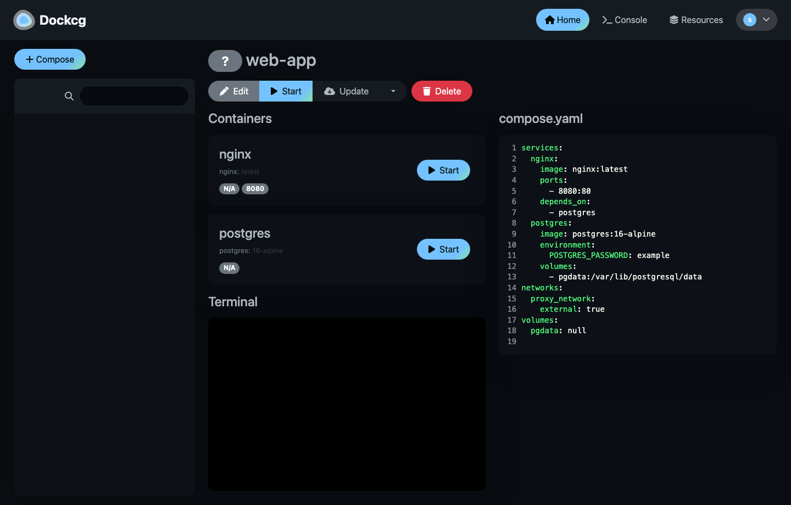
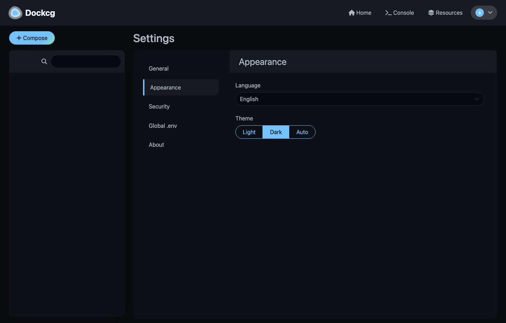

<div align="center" width="100%">
    
</div>

# Dockcg

A fancy, easy-to-use and reactive self-hosted docker compose.yaml stack-oriented manager.

> **About this fork** — Dockcg is a personal fork of [Dockge](https://github.com/louislam/dockge); all credit for the original design and code goes upstream. On top of the compose-only workflow it adds a **System Resources** section (Images / Volumes / Networks / private Registries). Containers are still 100% managed by `compose.yaml`; nothing here can run a standalone container.
>
> The image under `strange-dragon/dockcg` is **not published yet**, so build it yourself:
> ```bash
> docker compose up -d --build          # uses the build section in compose.yaml
> # or
> docker build -f docker/Dockerfile --target release -t strange-dragon/dockcg:1 .
> ```

[](https://github.com/strange-dragon/dockcg) [](https://hub.docker.com/r/strange-dragon/dockcg/tags) [](https://hub.docker.com/r/strange-dragon/dockcg/tags) [](https://github.com/strange-dragon/dockcg/commits/master/)



## ⭐ Features

- 🧑‍💼 Manage your `compose.yaml` files
  - Create/Edit/Start/Stop/Restart/Delete
  - Update Docker Images
- ⌨️ Interactive Editor for `compose.yaml`
- 🦦 Interactive Web Terminal
- 🕷️ Multiple agents support - You can manage multiple stacks from different Docker hosts in one single interface
- 🏪 Convert `docker run ...` commands into `compose.yaml`
- 📙 File based structure - Dockcg won't kidnap your compose files, they are stored on your drive as usual. You can interact with them using normal `docker compose` commands
- 🚄 Reactive - Everything is just responsive. Progress (Pull/Up/Down) and terminal output are in real-time
- 🐣 Easy-to-use & fancy UI
- 🌐 English and Simplified Chinese only, English by default (`Settings → Appearance → Language`)

### Added in this fork: System resources

Read-only inventory plus targeted cleanup for everything `compose.yaml` doesn't own directly. Container lifecycle is deliberately **not** exposed here.

- **Images** – tag/size/created with in-use, unused and dangling state resolved from `com.docker.compose.project` labels, pre-pull with live terminal progress, per-image delete, prune of unused/dangling images
- **Volumes** – mountpoint/driver/scope, which stack + service + container mounts it, delete, prune of unattached volumes (compose-owned volumes are skipped unless you opt in)
- **Networks** – bridge/overlay/host with subnet and internal flags, owning stack, attached containers, cross-stack `external: true` snippet generator, prune
- **Registries** – Docker Hub / ghcr.io / Harbor credentials, `docker login` performed in the background, password encrypted at rest and never returned to the client

Cleanup never shells out to `docker prune`: the backend computes candidates and removes them one by one, refusing anything still in use or owned by a compose project.



## 🔧 How to Install

Requirements:
- [Docker](https://docs.docker.com/engine/install/) 20+ / Podman
- (Podman only) podman-docker (Debian: `apt install podman-docker`)
- OS:
  - Major Linux distros that can run Docker/Podman such as:
     - ✅ Ubuntu
     - ✅ Debian (Bullseye or newer)
     - ✅ Raspbian (Bullseye or newer)
     - ✅ CentOS
     - ✅ Fedora
     - ✅ ArchLinux
  - ❌ Debian/Raspbian Buster or lower is not supported
  - ❌ Windows (Will be supported later)
- Arch: armv7, arm64, amd64 (a.k.a x86_64)

### Basic

- Default Stacks Directory: `/opt/stacks`
- Default Port: 5001

```
# Create directories that store your stacks and stores Dockcg's stack
mkdir -p /opt/stacks /opt/dockcg
cd /opt/dockcg

# Download the compose.yaml
curl https://raw.githubusercontent.com/strange-dragon/dockcg/master/compose.yaml --output compose.yaml

# Start the server (builds the image locally, it is not published yet)
docker compose up -d --build

# If you are using docker-compose V1 or Podman
# docker-compose up -d --build
```

Dockcg is now running on http://localhost:5001

### Advanced

If you want to store your stacks in another directory, edit the `DOCKCG_STACKS_DIR` environment variable and the volume mount in `compose.yaml` directly.

Also, add the `PUID` and `PGID` section below to your compose `environment:` section to set stack ownership, otherwise default is `root`

```
      # Both PUID and PGID must be set for it to do anything
      - PUID=1000 # Set the stack file/dir ownership to this user
      - PGID=1000 # Set the stack file/dir ownership to this group
```

### -OR-
Copy and paste your compose from the following:

If you want to store your stacks in another directory, you can change the `DOCKCG_STACKS_DIR` environment variable and volumes.

compose:
```
services:
  dockcg:
    image: strange-dragon/dockcg:1
    restart: unless-stopped
    ports:
      # Host Port:Container Port
      - 5001:5001
    volumes:
      - /var/run/docker.sock:/var/run/docker.sock
      - ./data:/app/data
        
      # If you want to use private registries, you need to share the auth file with Dockcg:
      # - /root/.docker/:/root/.docker

      # Stacks Directory
      # Your stacks directory in the host (The paths inside container must be the same as the host)
      # ⚠️ If you did it wrong, your data could end up be written into a wrong path.
      # ✔️ CORRECT EXAMPLE: - /my-stacks:/my-stacks (Both paths match)
      # ❌ WRONG EXAMPLE: - /docker:/my-stacks (Both paths do not match)
      - /opt/stacks:/opt/stacks
    environment:
      # Tell Dockcg where your stacks directory is
      - DOCKCG_STACKS_DIR=/opt/stacks
      # Both PUID and PGID must be set for it to do anything
      - PUID=1000 # Set the stack file/dir ownership to this user
      - PGID=1000 # Set the stack file/dir ownership to this group
```

## How to Update

```bash
cd /opt/dockcg
git pull            # if you cloned this repo
docker compose build && docker compose up -d
```

## Screenshots

Taken from this fork running locally (English, dark theme). The stack list is empty in a few of them because that machine had no Docker daemon attached — the rest of the layout is what you get after `compose up`.


## Dependencies

This fork does not pull anything from the upstream author's Docker Hub namespace, and it does not call any upstream-hosted service:

| Thing | Status in this fork |
|---|---|
| Base image `louislam/dockge:base` | **Removed** — `docker/Dockerfile` now builds from `node:22-bookworm-slim`, installs `docker-ce-cli` + `docker-compose-plugin` itself |
| Healthcheck image `louislam/dockge:build-healthcheck` | **Removed** — compiled from `extra/healthcheck.go` in a `golang:1.21-bookworm` stage inside the same Dockerfile |
| `docker/Base.Dockerfile`, `docker/BuildHealthCheck.Dockerfile` | **Deleted** — they only existed to publish those two upstream images |
| npm dependencies | Ordinary public packages (`express`, `socket.io`, `vue`, …) pinned by `package-lock.json`; `npm ci` is fully reproducible |
| `@louislam/sqlite3` | A regular npm package from the public registry (a SQLite binding with Node 22 prebuilt binaries). If you want zero `louislam`-scoped packages, the alternatives are compiling official `sqlite3` from source in the image or migrating to `better-sqlite3` — both need real code changes, not a rename |
| README screenshots / demo video | **Replaced** — the images above are captured from this fork, not hot-linked from the upstream repo |

The only remaining upstream reference is the attribution link in the first paragraph.


## Motivations

- I have been using Portainer for some time, but for the stack management, I am sometimes not satisfied with it. For example, sometimes when I try to deploy a stack, the loading icon keeps spinning for a few minutes without progress. And sometimes error messages are not clear.
- Try to develop with ES Module + TypeScript

If you love this project, please consider giving it a ⭐.


## 🗣️ Community and Contribution

### Bug Report
https://github.com/strange-dragon/dockcg/issues

### Ask for Help / Discussions
https://github.com/strange-dragon/dockcg/discussions

### Translation
If you want to translate Dockcg into your language, please read [Translation Guide](https://github.com/strange-dragon/dockcg/blob/master/frontend/src/lang/README.md)

### Create a Pull Request

Be sure to read the [guide](https://github.com/strange-dragon/dockcg/blob/master/CONTRIBUTING.md), as we don't accept all types of pull requests and don't want to waste your time.

## FAQ

#### "Dockcg"?

"Dockcg" is a coinage word which is created by myself. I originally hoped it sounds like `Dodge`, but apparently many people called it `Dockage`, it is also acceptable.

The naming idea came from Twitch emotes like `sadge`, `bedge` or `wokege`. They all end in `-ge`.

#### Can I manage a single container without `compose.yaml`?

The main objective of Dockcg is to try to use the docker `compose.yaml` for everything. If you want to manage a single container, you can just use Portainer or Docker CLI.

#### Can I manage existing stacks?

Yes, you can. However, you need to move your compose file into the stacks directory:

1. Stop your stack
2. Move your compose file into `/opt/stacks/<stackName>/compose.yaml`
3. In Dockcg, click the " Scan Stacks Folder" button in the top-right corner's dropdown menu
4. Now you should see your stack in the list

#### Is Dockcg a Portainer replacement?

Yes or no. Portainer provides a lot of Docker features. While Dockcg is currently only focusing on docker-compose with a better user interface and better user experience.

If you want to manage your container with docker-compose only, the answer may be yes.

If you still need to manage something like docker networks, single containers, the answer may be no.

#### Can I install both Dockcg and Portainer?

Yes, you can.

## Others

Dockcg is built on top of [Compose V2](https://docs.docker.com/compose/migrate/). `compose.yaml`  also known as `docker-compose.yml`.
