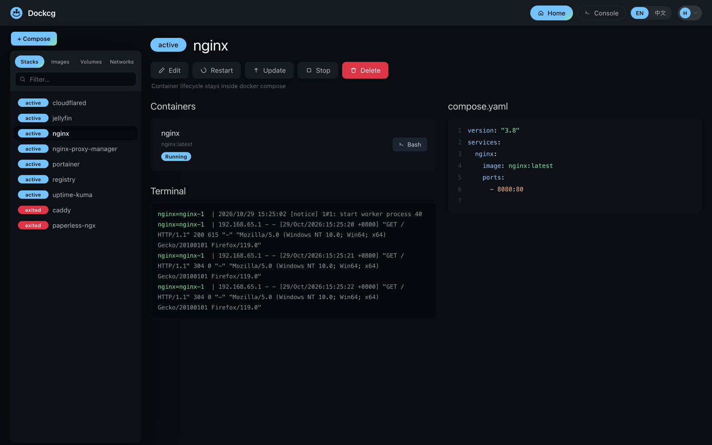
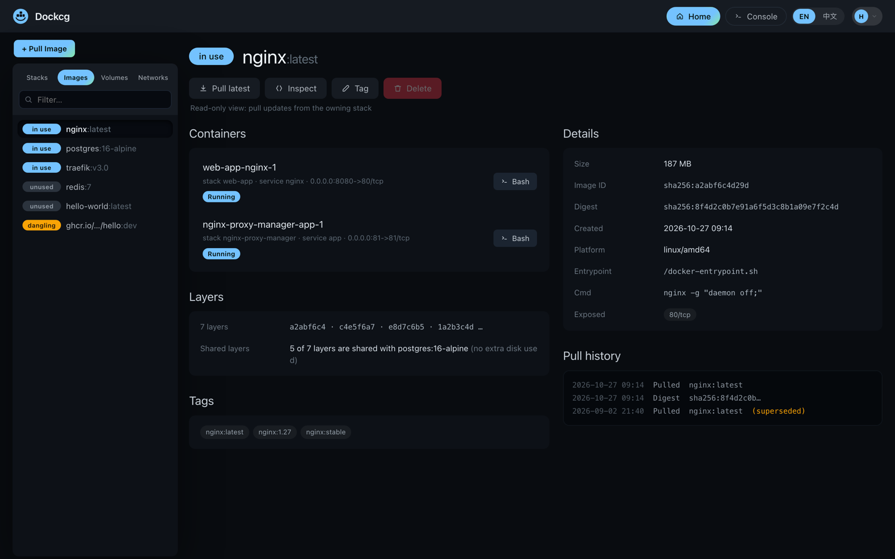
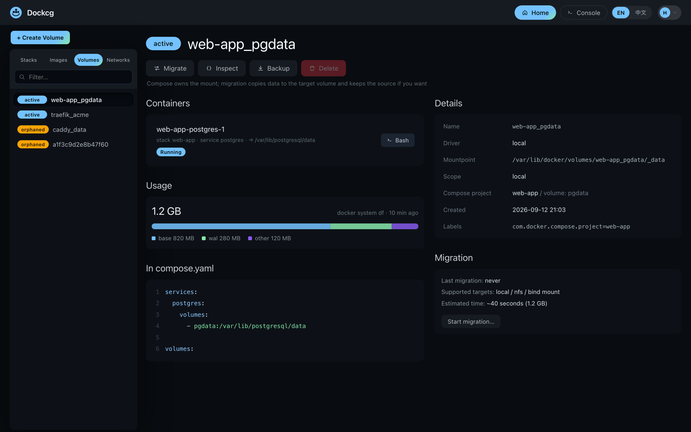

<div align="center" width="100%">
    
</div>

# Dockcg

A compose-first stack manager for Docker, forked from [Dockge](https://github.com/louislam/dockge) and extended with a **Docker resources** section: containers started outside compose, images, volumes, networks and registry credentials.

[](https://github.com/strange-dragon/dockcg) [](https://github.com/strange-dragon/dockcg/commits/master/) [](./LICENSE)



---

## Docker resources

New in this fork, on top of an otherwise unchanged compose workflow:

- **Containers** — read-only inventory; any container can be turned into a **Compose draft** (image, env, ports, mounts, restart policy, networks). The original is never stopped or deleted.
- **Images** — in-use / unused / dangling state, containers using each image, all tags of the same ID, digest, platform, targeted delete, previewed prune.
- **Volumes** — mountpoint, owning stack + service, orphan cleanup, disk usage on demand.
- **Networks** — inventory plus a relationship view: drag a service onto a network and its `compose.yaml` is edited for you (previewed, hash-guarded). Merge networks the same way. Unmanaged containers get an `external: true` snippet.
- **Registries** — Docker Hub / ghcr.io / Harbor credentials, `docker login` in the background, password encrypted at rest.
- **Overview** — one page with counts and previewed cleanup for all four resource types.

Nothing here creates an image, volume or network: **new objects only ever come from a compose file**, and the resources section can inspect, edit the compose file or delete — never add.

Three rules are enforced in code, not just documented: **no container lifecycle outside compose**, **changes go into `compose.yaml` instead of hidden CLI calls**, and **cleanup is itemised — never `docker prune`**.

| Images | Volumes |
|---|---|
|  |  |

Everything else — stack management, the editor, the terminal, agent setup, stack-folder scanning — is upstream behaviour; see [Dockge's README](https://github.com/louislam/dockge).

---

## 🔧 Install

### Requirements

- Docker 20+ with the `docker compose` plugin (or Podman + `podman-docker`)
- Linux: Ubuntu, Debian/Raspbian Bullseye+, CentOS, Fedora, Arch. Windows is not supported
- `amd64`, `arm64` or `armv7`

> Images live on GitHub Container Registry: `ghcr.io/strange-dragon/dockcg` — `latest` (tagged releases), `nightly` and `edge` (every push to master), plus version tags.
>
> If `docker pull` answers `denied` or `unauthorized`, the **package** is still private. Git repository visibility and package visibility are two separate switches: open the package settings on GitHub and set visibility to **Public**. After that no `docker login` is needed, for anyone.

### Quick start

```bash
mkdir -p /opt/stacks /opt/dockcg
cd /opt/dockcg

curl https://raw.githubusercontent.com/strange-dragon/dockcg/master/compose.yaml --output compose.yaml
docker compose up -d
```

Open <http://localhost:5001> and create the admin account. No build step, no login — the image is pulled in a few seconds.

### compose.yaml

```yaml
services:
  dockcg:
    image: ghcr.io/strange-dragon/dockcg:latest
    # build:                    # build from source instead of pulling
    #   context: .
    #   dockerfile: docker/Dockerfile
    #   target: release
    restart: unless-stopped
    ports:
      - 5001:5001
    volumes:
      - /var/run/docker.sock:/var/run/docker.sock   # required
      - ./data:/app/data                            # database + settings
      # - /root/.docker/:/root/.docker              # optional: keep registry logins
      - /opt/stacks:/opt/stacks                     # must be identical on both sides
    environment:
      - DOCKCG_STACKS_DIR=/opt/stacks
```

⚠️ The stacks mount must be the same absolute path on both sides (`/opt/stacks:/opt/stacks`), otherwise `docker compose` on the host cannot see the files Dockcg writes.

### Environment variables

| Variable | Default | Purpose |
|---|---|---|
| `DOCKCG_STACKS_DIR` | `/opt/stacks` | Where stacks live inside the container. |
| `DOCKCG_DATA_DIR` | `/app/data` | SQLite database, settings, agent list. |
| `DOCKCG_PORT` | `5001` | HTTP port inside the container. |
| `DOCKCG_HOSTNAME` | auto | Hostname shown in the UI. |
| `DOCKCG_SSL_KEY` / `DOCKCG_SSL_CERT` / `DOCKCG_SSL_KEY_PASSPHRASE` | — | Serve HTTPS directly. |
| `DOCKCG_ENABLE_CONSOLE` | `true` | `false` hides the global terminal. |
| `DOCKCG_HIDE_LOG` | — | `1` drops the log prefix. |
| `PUID` / `PGID` | `root` | Ownership of stack files (both required). |
| `TZ` | container | Log timestamps, e.g. `Asia/Shanghai`. |

Reverse proxy setups (Caddy / nginx / Traefik, websocket included) are in [docs/reverse-proxy.md](./docs/reverse-proxy.md).

### Upgrade and backup

```bash
docker compose pull && docker compose up -d                 # upgrade (or use a version tag)

docker compose stop                                         # backup
tar czf dockcg-backup-$(date +%F).tar.gz data /opt/stacks
docker compose start
```

### Coming from Dockge

```bash
mv /opt/dockge/data /opt/dockcg/data
mv /opt/dockcg/data/dockge.db /opt/dockcg/data/dockcg.db
```

Then rename `DOCKGE_STACKS_DIR` → `DOCKCG_STACKS_DIR` in your compose file, keep the stacks directory where it is, and log in with your existing account. Registry credentials are not migrated; add them under `Settings → Registries`.

### Build from source

```bash
docker build -f docker/Dockerfile --target release -t ghcr.io/strange-dragon/dockcg:dev .
```

`docker/Dockerfile` is self-contained — no host-side `npm` run is required. A `golang` stage compiles the healthcheck, a `node:22-bookworm-slim` stage installs `docker-ce-cli`, `compose-plugin`, `dumb-init` and `tsx`, a `build_frontend` stage runs `vite build` with dev dependencies, and the runtime stage receives only production `node_modules` plus `frontend-dist`. Nothing is pulled from a third-party Docker Hub namespace.

When `download.docker.com` is slow, point the Docker apt repo at a mirror:

```bash
docker build -f docker/Dockerfile --target release \
  --build-arg DOCKER_APT_BASE=https://mirrors.aliyun.com/docker-ce/linux/debian \
  -t ghcr.io/strange-dragon/dockcg:dev .
```

---

## Known limitations

- Nothing is created here — no containers, images, volumes or networks. New objects come from a compose file. The Containers tab only produces a draft.
- Network changes only touch containers owned by a managed stack, and nothing is deployed for you.
- Prune never removes a volume or network still declared in a managed Compose file.
- English and Simplified Chinese only; English by default.

## Credit

The application, UI, editor, terminal and agent protocol are [louislam/dockge](https://github.com/louislam/dockge) under MIT. This fork adds the resources module and rebrands. Report core bugs upstream; open issues for the resources module [here](https://github.com/strange-dragon/dockcg/issues).

## License

MIT, inherited from Dockge. The original copyright notice is kept in [LICENSE](./LICENSE).

---

<sub>中文版见 [README.zh-CN.md](./README.zh-CN.md)。</sub>
