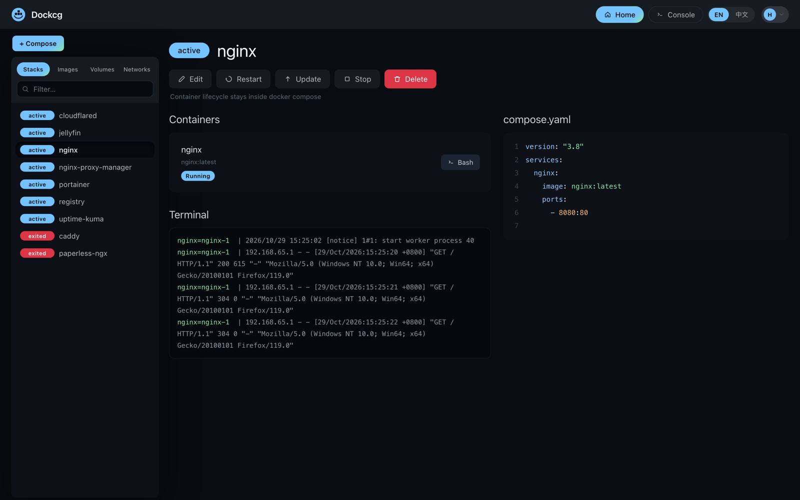
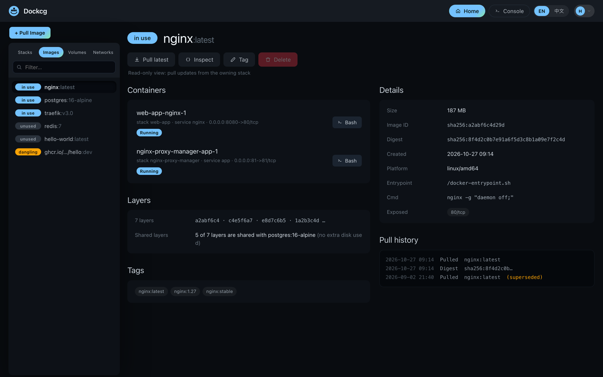
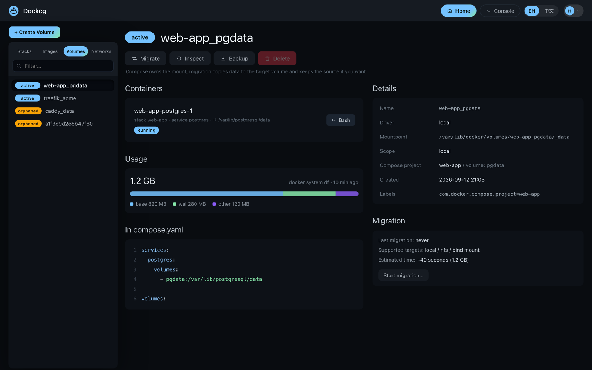

<div align="center" width="100%">
    
</div>

# Dockcg

一个以 compose 为中心的 Docker 堆栈管理器，fork 自 [Dockge](https://github.com/louislam/dockge)，并扩展出「Docker 资源」模块：在 compose 之外启动的容器、镜像、存储卷、网络和仓库凭据。

[](https://github.com/strange-dragon/dockcg) [](https://github.com/strange-dragon/dockcg/commits/master/) [](./LICENSE)



---

## Docker 资源

本 fork 新增，其余 compose 工作流保持不变：

- **容器** —— 只读清点；任意容器都能转成 **Compose 草稿**（镜像、环境变量、端口、挂载、重启策略、网络），原容器不停不删。
- **镜像** —— 使用中 / 未使用 / 悬空状态，使用该镜像的容器、同 ID 的全部标签、摘要、平台，定向删除，清理前先预览。
- **存储卷** —— 挂载点、归属堆栈与服务、孤儿卷清理、按需算磁盘占用。
- **网络** —— 清点之外还有关联视图：把服务拖到网络上，自动改写它的 `compose.yaml`（先预览、带哈希校验）。合并网络走同一路径。未纳管容器给 `external: true` 片段。
- **仓库** —— Docker Hub / ghcr.io / Harbor 凭据，后台执行 `docker login`，口令加密落库。
- **概览** —— 一页看完四类资源的数量，并从同一处发起带预览的清理。

资源模块不新增任何对象 —— **镜像、卷、网络都只能来自 compose 文件**，这里能做的只有查看、改 compose 和删除。

三条规则写在代码里，不只是写在文档里：**容器生命周期不出 compose**、**改动用 `compose.yaml` 承载而不是隐藏的 CLI 调用**、**清理逐项进行，绝不 `docker prune`**。

| 镜像 | 存储卷 |
|---|---|
|  |  |

其余部分 —— 堆栈管理、编辑器、终端、agent 配置、扫描堆栈目录 —— 都是上游原有行为，见 [Dockge 的 README](https://github.com/louislam/dockge)。

---

## 🔧 安装

### 环境要求

- Docker 20+ 且带 `docker compose` 插件（或 Podman + `podman-docker`）
- Linux：Ubuntu、Debian/Raspbian Bullseye 及以上、CentOS、Fedora、Arch。不支持 Windows
- `amd64`、`arm64` 或 `armv7`

> 镜像发布在 GitHub 容器仓库：`ghcr.io/strange-dragon/dockcg` —— `latest`（打标签的正式版）、`nightly` 与 `edge`（master 每次提交）、以及版本号标签。
>
> 如果 `docker pull` 报 `denied` / `unauthorized`，说明**包**还是私有的。Git 仓库公开和容器包公开是两个独立开关：到 GitHub 的包设置里把可见性改成 **Public**，之后任何人不登录都能拉。

### 快速开始

```bash
mkdir -p /opt/stacks /opt/dockcg
cd /opt/dockcg

curl https://raw.githubusercontent.com/strange-dragon/dockcg/master/compose.yaml --output compose.yaml
docker compose up -d
```

打开 <http://localhost:5001>，创建管理员账号。不用构建、不用登录，镜像几秒拉完。

### compose.yaml

```yaml
services:
  dockcg:
    image: ghcr.io/strange-dragon/dockcg:latest
    # build:                    # 想从源码构建就取消注释
    #   context: .
    #   dockerfile: docker/Dockerfile
    #   target: release
    restart: unless-stopped
    ports:
      - 5001:5001
    volumes:
      - /var/run/docker.sock:/var/run/docker.sock   # 必需
      - ./data:/app/data                            # 数据库 + 设置
      # - /root/.docker/:/root/.docker              # 可选：保留仓库登录态
      - /opt/stacks:/opt/stacks                     # 两侧路径必须一致
    environment:
      - DOCKCG_STACKS_DIR=/opt/stacks
```

⚠️ 堆栈挂载两侧必须是同一个绝对路径（`/opt/stacks:/opt/stacks`），否则宿主机的 `docker compose` 看不到 Dockcg 写的文件。

### 环境变量

| 变量 | 默认值 | 作用 |
|---|---|---|
| `DOCKCG_STACKS_DIR` | `/opt/stacks` | 容器内堆栈目录。 |
| `DOCKCG_DATA_DIR` | `/app/data` | SQLite 数据库、设置、agent 列表。 |
| `DOCKCG_PORT` | `5001` | 容器内 HTTP 端口。 |
| `DOCKCG_HOSTNAME` | 自动 | 界面显示的主机名。 |
| `DOCKCG_SSL_KEY` / `DOCKCG_SSL_CERT` / `DOCKCG_SSL_KEY_PASSPHRASE` | — | 直接提供 HTTPS。 |
| `DOCKCG_ENABLE_CONSOLE` | `true` | `false` 隐藏全局终端。 |
| `DOCKCG_HIDE_LOG` | — | `1` 不打印日志前缀。 |
| `PUID` / `PGID` | `root` | 堆栈文件所有者（两个都要设）。 |
| `TZ` | 容器默认 | 日志时区，如 `Asia/Shanghai`。 |

反向代理（Caddy / nginx / Traefik，含 websocket）见 [docs/reverse-proxy.md](./docs/reverse-proxy.md)。

### 升级与备份

```bash
docker compose pull && docker compose up -d                 # 升级（也可指定版本号标签）

docker compose stop                                         # 备份
tar czf dockcg-backup-$(date +%F).tar.gz data /opt/stacks
docker compose start
```

### 从 Dockge 迁移

```bash
mv /opt/dockge/data /opt/dockcg/data
mv /opt/dockcg/data/dockge.db /opt/dockcg/data/dockcg.db
```

然后把 compose 文件里的 `DOCKGE_STACKS_DIR` 改成 `DOCKCG_STACKS_DIR`，堆栈目录原地不动，用原账号登录即可。仓库凭据不会迁移，到 `设置 → 私有仓库` 重新添加。

### 从源码构建

```bash
docker build -f docker/Dockerfile --target release -t ghcr.io/strange-dragon/dockcg:dev .
```

`docker/Dockerfile` 自包含，宿主机不需要先跑 `npm`：`golang` 阶段编译健康检查，`node:22-bookworm-slim` 阶段装 `docker-ce-cli`、`compose-plugin`、`dumb-init`、`tsx`，`build_frontend` 阶段用 devDependencies 跑 `vite build`，运行时阶段只拿生产依赖和 `frontend-dist`。不从任何第三方 Docker Hub 命名空间拉东西。

`download.docker.com` 慢的时候可以让 Docker 的 apt 源走国内镜像：

```bash
docker build -f docker/Dockerfile --target release \
  --build-arg DOCKER_APT_BASE=https://mirrors.aliyun.com/docker-ce/linux/debian \
  -t ghcr.io/strange-dragon/dockcg:dev .
```

---

## 已知限制

- 这里不创建任何东西 —— 容器、镜像、卷、网络都不行。新增只来自 compose 文件，容器标签只生成草稿。
- 网络变更只作用于归属受管理堆栈的容器，且不会替你部署。
- 清理不会删除仍在受管理 Compose 文件中声明的卷或网络。
- 界面只有英文与简体中文，默认英文。

## 署名

应用本体、UI、编辑器、终端和 agent 协议来自 MIT 协议下的 [louislam/dockge](https://github.com/louislam/dockge)。本项目只加了资源模块并做了重命名。核心功能的问题请反馈上游；资源模块的问题提[这里](https://github.com/strange-dragon/dockcg/issues)。

## 许可证

MIT，继承自 Dockge，原始版权声明保留在 [LICENSE](./LICENSE)。

---

<sub>English version: [README.md](./README.md).</sub>
